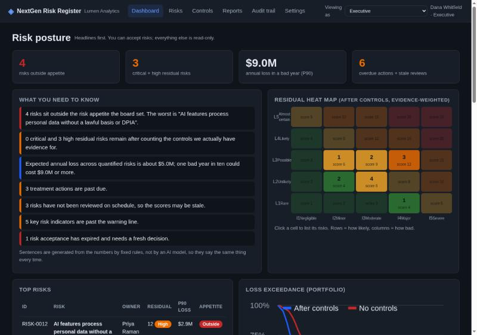
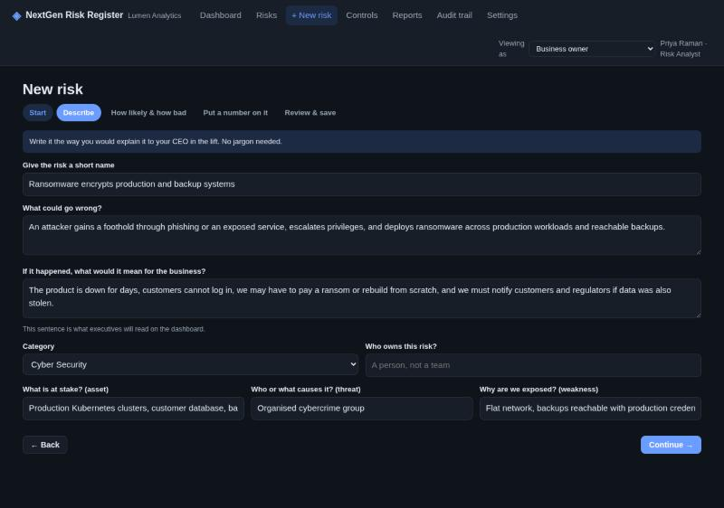
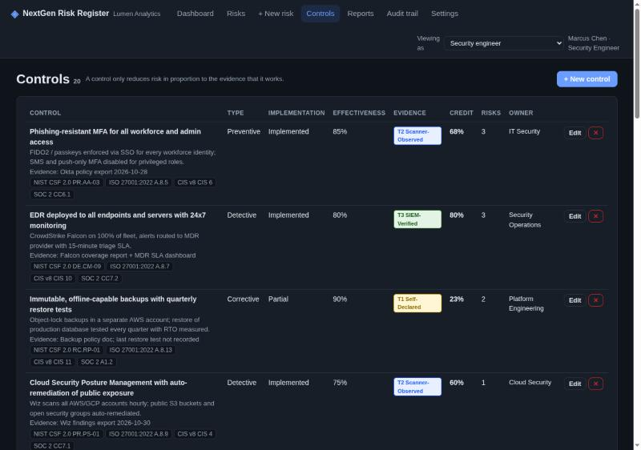

# NextGen Risk Register

A risk register that speaks plain English to the business and MITRE / FAIR / ISO to engineers.

Most risk registers are spreadsheets with a colour-coded 5×5 grid, a "residual" column somebody typed by hand, and a review date nobody checks. This project is what a register looks like when it is built the way security engineers build systems: every score is **deterministic and reproducible**, control credit is **discounted by the quality of the evidence** behind it, financial exposure is **simulated, not guessed**, and every change is written to a **hash-chained audit trail**. A non-technical risk owner can add a risk in four plain-English screens; a security engineer sees the same risk with ATT&CK techniques, CVSS, OWASP LLM Top 10 and control evidence tiers.

Built for an AI-first cloud SaaS company (the demo tenant is "Lumen Analytics"), with scenarios mapped to NIST CSF 2.0, ISO 27001:2022, SOC 2, NIST AI RMF, OWASP LLM Top 10 (2025), CIS v8, GDPR, MITRE ATT&CK and MITRE ATLAS.

| Executive dashboard | Business intake wizard | Evidence-tiered controls |
|---|---|---|
|  |  |  |

---

## Quick start

```bash
pip install -r requirements.txt
python run.py
```

Open <http://127.0.0.1:8000>. The first run seeds the Lumen Analytics demo dataset (12 risks, 20 controls, treatments, KRIs, one expired acceptance). Interactive API docs are at <http://127.0.0.1:8000/docs>.

Useful variations:

```bash
python run.py --reseed        # wipe and rebuild the demo dataset
python run.py --empty         # start with an empty register
python run.py --reload        # auto-reload during development
python -m pytest -q           # run the test suite
```

Docker:

```bash
docker compose up --build     # http://localhost:8000, data persisted in ./data
```

Requirements: Python 3.11+ (developed on 3.14), no Node, no build step, no external services.

---

## What makes it next-gen

Each bullet names a gap in spreadsheet or legacy GRC registers and the feature that closes it. The long version is in [docs/GAPS_ANALYSIS.md](docs/GAPS_ANALYSIS.md).

- **One register, four audiences.** A persona switcher (Business / Security Engineer / Executive / Auditor) changes language, visible fields and permissions. The business owner never sees a CVSS field; the engineer never has to decode "a bad quarter".
- **Guided plain-English intake with an impact translator.** The New Risk wizard asks "what could go wrong, who does it hurt, how often, how bad" using word cards with descriptions, and translates dollars and frequencies into the 5×5 scale (and back) so the two views never disagree.
- **Hybrid scoring: 5×5 matrix and FAIR-style quantification side by side.** Every risk has a qualitative score; any risk can also carry loss-event-frequency and loss-magnitude ranges. A seeded Monte Carlo simulation produces mean / median / P90 / P95 annualised loss, the textbook ARO × SLE figure for comparison, and a loss-exceedance curve. Portfolio exposure is the per-simulation sum across risks, not the sum of means.
- **Evidence verification tiers for controls.** Adapted from the ResilAI / AIRS governance whitepaper: a control is *Self-Declared* (50% credit), *Scanner-Observed* (80%) or *SIEM-Verified* (100%). Tiers 2 and 3 require naming the evidence source. "We have a policy for that" does not move the heat map.
- **Residual risk is computed from linked controls, not typed.** Preventive controls reduce likelihood; detective and corrective controls reduce impact. Control stacking is overlap-aware (the strongest control counts in full, each further control covers half of what remains) and damped, so no amount of paperwork drives a risk to zero. A manual override is allowed and is logged as such.
- **Risk appetite per category, checked two ways.** Each category has a maximum residual score and a maximum P90 annual loss. A risk is "outside appetite" if it breaches either, and the dashboard says so in a sentence.
- **Treatment plans that can be late.** Mitigate / Accept / Transfer / Avoid actions with owners, due dates, progress and cost. Overdue actions surface on the dashboard and in the board report.
- **Key Risk Indicators with thresholds and history.** Each KRI has warning and critical lines, a direction, a source, and a reading history; breaches roll up to the risk and the dashboard.
- **Time-boxed risk acceptance.** Acceptances need a rationale, an approver with the right role, and an expiry no more than 12 months out. Expired acceptances are flagged until a fresh decision is recorded.
- **Hash-chained audit trail.** Every create, update, review, link, acceptance, reading and upload is appended with a SHA-256 hash covering the previous entry. `GET /api/audit/verify` proves the chain is intact; the board report prints the chain head.
- **Review cadence and staleness.** Each risk has a review frequency; overdue reviews are visible everywhere the risk is.
- **Role-based access.** Executives can accept risks but not edit them; auditors can read everything and change nothing; analysts own settings, appetite and imports.
- **Bring your spreadsheet with you.** CSV import with a downloadable template, fuzzy category matching, and per-row error reporting. CSV and JSON export of the full register.
- **Printable board report.** One HTML page, no JavaScript: headlines, appetite table, residual heat map, open risks, overdue actions, control assurance and audit integrity.
- **Scenario library for AI and cloud SaaS.** Fourteen ready-to-adopt risks (ransomware, prompt injection, excessive agency, data poisoning, cloud misconfiguration, secrets leakage, supply chain, sub-processor breach, insider exfiltration, BEC, inference DoS, GDPR and AI processing, unpatched exploitation, credential stuffing) with business-language impact statements, FAIR defaults, ATT&CK / ATLAS techniques, framework citations and suggested controls.

---

## Architecture

```
frontend/            vanilla HTML + CSS + JS, hash-routed single page, no build step
backend/main.py      FastAPI routes, Pydantic validation, role checks, import/export, evidence upload
backend/service.py   assembles rows + links into enriched risks, dashboard, export rows
backend/scoring.py   pure deterministic scoring engine (5x5, control credit, FAIR Monte Carlo, appetite)
backend/audit.py     hash-chained append-only audit log
backend/reports.py   self-contained board report HTML
backend/frameworks.py, scenarios.py   reference data (frameworks, ATT&CK/ATLAS, scenario library, starter controls)
backend/db.py        sqlite3 (stdlib) schema and helpers
backend/seed.py      Lumen Analytics demo tenant
```

Design rules:

- **Zero LLM in the scoring path.** Scores, bands, residuals, simulations and headlines are produced by pure Python. Same inputs, same outputs, every time. This follows the dual-engine principle in the ResilAI / AIRS whitepaper: narrative generation may be probabilistic, the system of record may not.
- **Seeded Monte Carlo.** The random generator is seeded from the risk ID, so an auditor can re-run a simulation and get the identical P90.
- **One SQLite file.** `data/register.db` is the entire register; evidence files sit beside it in `data/evidence/`. Back up the folder, hand it to an auditor, done.
- **Audit log is append-only by construction.** Nothing in the API deletes or edits audit rows; tampering with the file is detectable.

Full formulas and rationale: [docs/METHODOLOGY.md](docs/METHODOLOGY.md).

---

## Roles and demo users

Identity is demo-grade: the UI sends an `X-Actor` header with a user ID, the server resolves the role and enforces permissions. There is no password. See *Limitations* below.

| Header `X-Actor` | Name            | Role              | Can                                                        |
|------------------|-----------------|-------------------|------------------------------------------------------------|
| `u-ceo`          | Dana Whitfield  | Executive         | read everything, accept risks                              |
| `u-ciso`         | Priya Raman     | Risk Analyst      | everything, including delete, settings, appetite, imports  |
| `u-eng`          | Marcus Chen     | Security Engineer | create and edit risks, controls, treatments, KRIs, evidence|
| `u-audit`        | Elena Novak     | Auditor           | read everything, change nothing                            |

Persona switcher mapping in the UI: Business → `u-ciso`, Security Engineer → `u-eng`, Executive → `u-ceo`, Auditor → `u-audit`.

---

## API overview

Swagger UI at `/docs`. All write endpoints require a role with the matching permission; a denied call returns `403` and is logged.

| Area        | Endpoints                                                                                                           |
|-------------|---------------------------------------------------------------------------------------------------------------------|
| Meta        | `GET /api/meta` (scales, bands, tiers, frameworks, techniques, scenarios, users, appetite), `GET /api/whoami`        |
| Risks       | `GET/POST /api/risks`, `GET/PUT/DELETE /api/risks/{id}`, `POST /api/risks/from-scenario/{key}`, `POST /api/risks/{id}/review`, `POST/DELETE /api/risks/{id}/controls/{cid}`, `POST /api/risks/{id}/accept` |
| Scoring     | `POST /api/simulate` (live FAIR preview), `POST /api/translate` (dollars / frequency → scale level), `GET /api/fair-defaults` |
| Controls    | `GET/POST /api/controls`, `PUT/DELETE /api/controls/{id}`                                                           |
| Treatments  | `GET/POST /api/treatments`, `PUT/DELETE /api/treatments/{id}`                                                       |
| KRIs        | `GET/POST /api/kris`, `PUT/DELETE /api/kris/{id}`, `POST /api/kris/{id}/readings`                                   |
| Evidence    | `POST /api/evidence` (multipart, 10 MB limit, SHA-256 recorded), `GET /api/evidence`, `GET /api/evidence/{id}/download` |
| Audit       | `GET /api/audit`, `GET /api/audit/verify`                                                                           |
| Reporting   | `GET /api/dashboard`, `GET /api/reports/board` (HTML), `GET /api/export/csv`, `GET /api/export/json`                 |
| Import      | `GET /api/import/template`, `POST /api/import/csv`                                                                  |
| Settings    | `PUT /api/settings`, `PUT /api/appetite`                                                                            |

---

## Project layout

```
nextgen-risk-register/
├── run.py                 start script (seeds demo data on first run)
├── requirements.txt
├── Dockerfile, docker-compose.yml
├── backend/               FastAPI application (see Architecture)
├── frontend/              index.html, styles.css, app.js
├── tests/                 pytest: scoring engine, audit chain, end-to-end API
├── docs/
│   ├── METHODOLOGY.md     scoring formulas, worked example, rationale and references
│   ├── GAPS_ANALYSIS.md   what is wrong with typical registers and what this does about it
│   └── INTERVIEW_GUIDE.md five-minute demo path and likely interview questions
└── data/                  created at runtime: register.db and evidence/ (git-ignored)
```

---

## Testing

```bash
python -m pytest -q
```

The suite covers the scoring engine (band boundaries, control credit, overlap stacking, damping, simulation determinism and monotonicity, a hand-computed worked example that must match `docs/METHODOLOGY.md`), the audit chain (tamper and delete detection) and the full API against a temporary seeded database (RBAC, validation, scenario creation, residual recomputation, acceptance rules, treatments, KRIs, evidence upload with hash check, dashboard shape, import/export, board report).

---

## Limitations and honest notes

- **Identity is a header, not authentication.** `X-Actor` is trusted as given. This is deliberate for a portfolio project; in production it would sit behind SSO (OIDC) and the header would be derived from the verified session.
- **Single tenant, single process.** One SQLite file, one organisation. Fine for a team register or a demo, not for a multi-customer platform.
- **The FAIR implementation is "FAIR-style", not a certified FAIR engine.** It uses PERT-distributed loss-event frequency and loss magnitude with Poisson event counts. It does not decompose frequency into threat event frequency and vulnerability, and it does not model secondary loss separately.
- **Control effectiveness is still an input.** Evidence tiers discount it, but someone still types the 0–100 number. The SIEM-Verified tier is a label today; nothing in this project ingests telemetry.
- **The scenario library is opinionated.** It targets an AI and cloud SaaS company. Financial services or healthcare registers would need different scenarios and appetite defaults.
- **No file-type scanning on evidence uploads.** Files are stored with a sanitised name and hash; they are not scanned for malware or inspected for content.

---

## Roadmap

- SSO (OIDC) and real sessions replacing the `X-Actor` header.
- Treatment synchronisation with Jira / ServiceNow so remediation work is tracked where engineers already work.
- SIEM webhook for KRIs (Splunk / Sentinel saved searches posting readings), making the SIEM-Verified tier real.
- Bow-tie view (threats → preventive controls → event → corrective controls → consequences) on the risk detail page.
- Multi-tenant mode with per-organisation appetite and scenario libraries.
- Risk-to-asset graph and dependency propagation.

---

## Documentation

- [docs/METHODOLOGY.md](docs/METHODOLOGY.md): every formula as implemented, a worked example, rationale and references.
- [docs/GAPS_ANALYSIS.md](docs/GAPS_ANALYSIS.md): fourteen gaps in typical registers and what this project does about each.
- [docs/INTERVIEW_GUIDE.md](docs/INTERVIEW_GUIDE.md): how to demo it in five minutes and how to answer the questions that follow.
